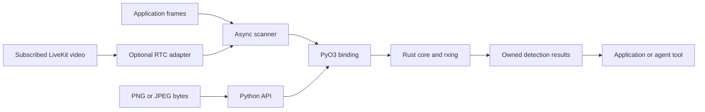

# Architecture

REED QR separates QR processing from video transport and application behavior.

Rust applications call the core directly. Text encoding follows the same public
boundary and returns a grayscale image and PNG bytes.

## Components

| Component | Responsibility |
| --- | --- |
| `crates/reed-qr-core` | Frame validation, grayscale conversion, PNG/JPEG loading, encoding, codec adaptation and result fidelity |
| `crates/reed-qr-python` | Private native extension, Python exceptions, buffer ownership and interpreter detachment |
| `python/reed_qr` | Typed public API, asynchronous scheduling, duplicate suppression and event delivery |
| `python/reed_qr/integrations/livekit.py` | Selected-track readers, RTC event reconciliation and source identity |

The core enables only rxing QR encoding/decoding and image PNG/JPEG support.
Codec types stay private. `qrcode` and Segno are independent test encoders.

## Ownership and scheduling

The Python boundary snapshots mutable buffers before native work. Synchronous
calls detach from the interpreter but wait on the calling thread. The scanner
uses a bounded thread pool, one replaceable pending frame per source, and a
bounded result queue. Sampling and duplicate suppression are per source.

Applications own camera capture, transport connections, authorization and agent
tool registration. The RTC adapter owns its readers and scanner; it does not own
the room or change subscription policy. Track replacement assigns a new source
generation and discards late results from the previous source.

Shutdown stops admission, drops pending work, waits for active native calls, and
closes readers and workers. Native decoding is not forcibly interrupted. See the
[streaming contract](docs/streaming.md) for queue, failure and cancellation semantics.

## Payloads

rxing raw result bytes contain QR codewords and are not treated as application
payload bytes. The core verifies byte-mode payloads, optionally with ECI, before
exposing complete `payload_bytes`. Numeric/alphanumeric modes return text.
Mixed modes and structured append retain available segments without labeling
them as a complete exact payload. Non-UTF-8 text is not generally guaranteed.

Landmarks identify detector points; the API does not infer four outer corners.
Application actions remain outside the codec and scanner.
